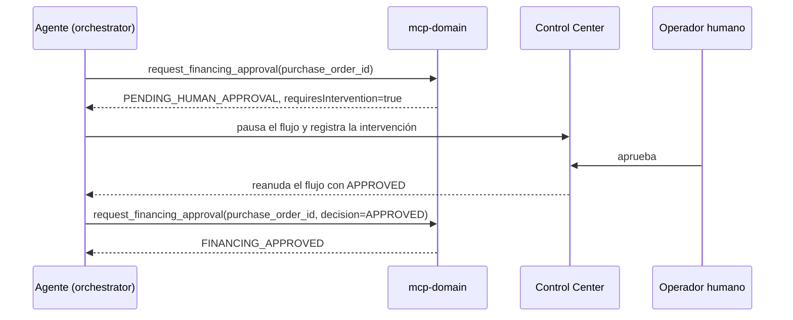

# Referencia de herramientas MCP

Este documento describe el contrato que `mcp-domain` publica por MCP: transporte, esquemas,
respuestas de ejemplo, idempotencia y errores. La implementación está en
`src/main/java/com/floworchestrator/mcpdomain/`.

## Transporte

- Protocolo: MCP sobre HTTP Streamable.
- Endpoint: `POST /mcp` en el puerto `9001` (configurable con `SERVER_PORT`).
- `serverInfo`: `mcp-domain`, versión `1.0.0`.
- Capacidades: `tools` con notificación de cambios; `resources` sin suscripción ni
  notificación de cambios.
- Instrucciones del servidor: describen el orden del flujo, la idempotencia y la regla de no
  inventar identificadores; el cliente las recibe al inicializar la sesión.

El servidor construye el transporte y registra las tools en
[McpServerConfiguration.java](../src/main/java/com/floworchestrator/mcpdomain/config/McpServerConfiguration.java).
Usa `validateToolInputs(false)`: el SDK no valida los argumentos contra el esquema JSON. Los
esquemas sirven para que el modelo sepa qué enviar; la validación efectiva la realizan
[ToolArguments.java](../src/main/java/com/floworchestrator/mcpdomain/tools/ToolArguments.java) y
las reglas de negocio. Por eso un campo desconocido se ignora en lugar de rechazarse, aunque el
esquema declare `additionalProperties=false`.

## Convenciones de argumentos

- Los identificadores obligatorios se recortan; un valor ausente, vacío, no textual o de más
  de 128 caracteres produce `MISSING_ARGUMENT` o `INVALID_ARGUMENT`.
- `idempotency_key` admite hasta 128 caracteres.
- Los campos opcionales de texto se recortan y, si quedan vacíos, usan el valor por defecto.
- Los montos deben ser números JSON finitos y mayores o iguales a cero.
- Los valores de `payment_type` y `financial_institution` se envían recortados de espacios; no
  se normaliza su mayúsculas. Solo `decision` se convierte a mayúsculas.

## `get_vehicle_information`

Consulta un vehículo del catálogo. Es de solo lectura y segura de reintentar.

### Argumentos

| Campo | Tipo | Obligatorio | Reglas |
| --- | --- | --- | --- |
| `vehicle_id` | string | Sí | Identificador del catálogo, por ejemplo `v-101`; 1 a 128 caracteres |

### Respuesta

El servicio devuelve el cuerpo del catálogo con `vehicle_id` garantizado. Los campos provienen
de `vehicle-domain-service`:

```json
{
  "vehicle_id": "v-101",
  "model_id": "m-202",
  "brand": "Toyota",
  "model": "Corolla",
  "year": 2024,
  "available": true,
  "price": 385000,
  "currency": "MXN"
}
```

La disponibilidad se publica en el campo `available` (booleano). Los campos nulos del catálogo
se omiten.

### Llamada downstream

`GET {AUTO_DATABASE_URL}/vehicles/{vehicle_id}` mediante
`VehicleCatalogRemoteRepository`.

### Errores

- `VEHICLE_NOT_FOUND`: el catálogo respondió 2xx sin datos. El mensaje pide confirmar el
  identificador y no reintentar con el mismo valor.
- `RESOURCE_NOT_FOUND`: el catálogo respondió 404. También indica un identificador inexistente,
  pero llega como error HTTP de Feign.
- `DEPENDENCY_UNAVAILABLE`: el catálogo respondió 5xx.

## `register_vehicle_purchase`

Crea la orden de compra que vincula cliente, vehículo y agente de ventas. Escribe datos y es
idempotente.

### Argumentos

| Campo | Tipo | Obligatorio | Reglas |
| --- | --- | --- | --- |
| `customer_id` | string | Sí | Identificador del cliente; 1 a 128 caracteres |
| `vehicle_id` | string | Sí | Identificador del vehículo; 1 a 128 caracteres |
| `sales_agent_id` | string | Sí | Identificador del agente de ventas; 1 a 128 caracteres |
| `idempotency_key` | string | No | Clave estable del intento; máximo 128 caracteres |

### Respuesta

```json
{
  "vehicle_id": "v-101",
  "purchase_order_id": "po-3f1c8d0e-7a4b-3c2d-9e8f-1a2b3c4d5e6f",
  "customer_id": "c-1001",
  "sales_agent_id": "a-42",
  "status": "CREATED",
  "message": "Orden registrada correctamente",
  "idempotent_replay": false
}
```

El mensaje final lo sobrescribe la respuesta del dominio. Si la orden ya existía para la misma
combinación de cliente y vehículo, `vehicle-domain-service` responde 200 con
`message="La orden ya estaba registrada; se reutiliza la existente"`; `mcp-domain` conserva ese
mensaje y mantiene `idempotent_replay=false` si esta instancia aún no había cacheado el
resultado.

Un reintento idéntico atendido desde la caché local devuelve la respuesta original con
`idempotent_replay=true`.

En el caso excepcional de que el dominio responda `409`, `mcp-domain` lo absorbe y añade
`reused_existing_order=true`:

```json
{
  "status": "CREATED",
  "message": "La orden ya estaba registrada; se reutiliza la existente",
  "reused_existing_order": true,
  "idempotent_replay": false
}
```

En el dominio actual, un `409 DATA_CONFLICT` significa que el `purchase_order_id` ya pertenece
a otro vehículo o cliente, no el replay normal de una compra idéntica (ese replay responde
200).

### Clave de idempotencia

La clave se calcula en
[VehicleDomainService.java](../src/main/java/com/floworchestrator/mcpdomain/service/VehicleDomainService.java):

- Con `idempotency_key`: `purchase:key:<uuid derivado de cliente + vehículo + agente + clave>`.
- Sin `idempotency_key`: `purchase:derived:<uuid derivado de cliente + vehículo + agente>`.
- `purchase_order_id`: `po-` + UUID derivado de la clave.

Consecuencias:

- Reintentar con los mismos datos reutiliza la orden.
- Enviar la misma `idempotency_key` con otro vehículo, cliente o agente genera una orden
  distinta; la clave explícita no sustituye a los datos de la compra.
- Para una compra idéntica adicional solicitada explícitamente por el usuario hay que usar una
  `idempotency_key` nueva.

### Llamada downstream

`POST {AUTO_DATABASE_URL}/purchase-orders` con `vehicle_id`, `purchase_order_id`,
`customer_id`, `sales_agent_id` y `status=CREATED`. Un `409 Conflict` se interpreta como orden
ya registrada y no se propaga como error.

### Errores

- `MISSING_ARGUMENT` si falta cualquiera de los tres identificadores.
- `INVALID_ARGUMENT` si un identificador no es texto, está vacío o excede 128 caracteres, o si
  el dominio rechaza la solicitud con 4xx.
- `DEPENDENCY_UNAVAILABLE` si el dominio responde 5xx.
- `ALREADY_EXISTS` no se produce en esta tool: el alta absorbe cualquier 409 y responde
  `reused_existing_order=true`.

## `set_payment_method`

Configura el pago de una orden existente. Solo `purchase_order_id` es obligatorio; los campos
omitidos usan los valores publicados en el recurso `payment-defaults`.

### Argumentos

| Campo | Tipo | Obligatorio | Por defecto | Reglas |
| --- | --- | --- | --- | --- |
| `purchase_order_id` | string | Sí | - | Identificador devuelto por `register_vehicle_purchase` |
| `payment_type` | string | No | `FINANCING` | Texto libre, por ejemplo `FINANCING` o `CASH` |
| `financial_institution` | string | No | `BBVA` | Institución financiera |
| `down_payment_amount` | number | No | `15000` | Finito y mayor o igual a cero |

### Respuesta

```json
{
  "purchase_order_id": "po-3f1c8d0e-7a4b-3c2d-9e8f-1a2b3c4d5e6f",
  "status": "PAYMENT_CONFIGURED",
  "payment_type": "FINANCING",
  "financial_institution": "BBVA",
  "down_payment_amount": 15000,
  "idempotent_replay": false
}
```

La respuesta combina los valores resueltos por `mcp-domain` con los campos que devuelve el
dominio (`purchase_order_id`, `status`, `payment_type`).

### Idempotencia

La clave es `payment:<uuid derivado de orden + tipo + institución + monto normalizado>`. El
monto se normaliza sin ceros finales, de modo que `15000` y `15000.0` producen la misma clave.
Cambiar cualquier valor genera una configuración nueva en lugar de reproducir la anterior.

### Llamada downstream

`POST {AUTO_DATABASE_URL}/payment-methods` con `purchase_order_id`, `payment_type`,
`financial_institution` y `down_payment_amount`.

### Errores

- `MISSING_ARGUMENT` si falta `purchase_order_id`.
- `INVALID_ARGUMENT` si el monto no es numérico, no es finito o es negativo, o si el dominio
  rechaza la solicitud con 4xx.
- `RESOURCE_NOT_FOUND` si la orden no existe en el dominio (404).
- `DEPENDENCY_UNAVAILABLE` si el dominio responde 5xx.

## `request_financing_approval`

Solicita la autorización humana de un financiamiento o confirma que ya fue aprobada. No llama
a `vehicle-domain-service`; su efecto es pausar o continuar el flujo del orquestador.

### Argumentos

| Campo | Tipo | Obligatorio | Reglas |
| --- | --- | --- | --- |
| `purchase_order_id` | string | Sí | Identificador de la orden |
| `decision` | string | No | Si se envía, solo se acepta `APPROVED` (sin distinguir mayúsculas) |

### Primera llamada: solicitar aprobación

Sin `decision`, la respuesta es:

```json
{
  "purchase_order_id": "po-3f1c8d0e-7a4b-3c2d-9e8f-1a2b3c4d5e6f",
  "status": "PENDING_HUMAN_APPROVAL",
  "requiresIntervention": true,
  "reason": "El financiamiento del vehículo requiere autorización de un operador humano.",
  "how_to_resume": "Aprueba la intervención en el Control Center; el flujo se reanuda y esta herramienta debe invocarse de nuevo con decision=APPROVED."
}
```

El orquestador interpreta `requiresIntervention=true` y pausa el proceso. El Control Center
registra la intervención y espera la decisión de un operador.

### Segunda llamada: confirmar aprobación

Con `decision=APPROVED`:

```json
{
  "purchase_order_id": "po-3f1c8d0e-7a4b-3c2d-9e8f-1a2b3c4d5e6f",
  "status": "FINANCING_APPROVED",
  "approved": true,
  "message": "Financiamiento aprobado por el operador humano."
}
```

### Rechazo

La tool no recibe el rechazo. Si el operador rechaza la intervención, el Control Center cancela
el proceso y el agente no debe volver a llamar a esta herramienta ni enviar el correo de
confirmación.

### Errores

- `MISSING_ARGUMENT` si falta `purchase_order_id`.
- `INVALID_ARGUMENT` si `decision` tiene un valor distinto de `APPROVED`.

### Secuencia completa



## Recurso `payment-defaults`

- URI: `floworchestrator://domain/payment-defaults`
- Nombre: `payment-defaults`
- MIME: `application/json`
- Contenido:

```json
{
  "payment_type": "FINANCING",
  "financial_institution": "BBVA",
  "down_payment_amount": 15000,
  "currency": "MXN",
  "notes": "set_payment_method aplica estos valores cuando se omite el argumento opcional correspondiente."
}
```

Los valores provienen de
[PaymentDefaults.java](../src/main/java/com/floworchestrator/mcpdomain/service/PaymentDefaults.java)
y son la única fuente de verdad: si cambian ahí, cambian tanto el recurso como los valores que
aplica `set_payment_method`.

## Catálogo de errores

Todos los errores se devuelven como contenido JSON con `isError=true`. El cuerpo incluye
`status`, `tool`, `error_code`, `message`, `how_to_fix`, `retryable` y, cuando aplica, `field`.

| Código | Significado | `retryable` | Acción esperada del agente |
| --- | --- | --- | --- |
| `MISSING_ARGUMENT` | Falta un campo obligatorio o está vacío | `false` | Pedir el dato al usuario y repetir con el campo establecido |
| `INVALID_ARGUMENT` | Tipo/formato inválido o rechazo 4xx del dominio | `false` | Corregir los argumentos antes de repetir |
| `VEHICLE_NOT_FOUND` | El catálogo no devolvió el vehículo | `false` | Confirmar el identificador con el usuario |
| `RESOURCE_NOT_FOUND` | El dominio respondió 404 | `false` | Confirmar los identificadores; no repetir igual |
| `ALREADY_EXISTS` | El dominio respondió 409 | `false` | Reutilizar el recurso existente y continuar |
| `DEPENDENCY_UNAVAILABLE` | El dominio respondió 5xx | `true` | Reintentar una vez; si falla, informar al usuario |
| `INTERNAL_ERROR` | Fallo inesperado de la tool | `false` | No reintentar; informar el fallo |
| `SERIALIZATION_ERROR` | La respuesta no se pudo serializar | `false` | No reintentar; informar el fallo |

El orden de traducción está en
[ToolErrors.java](../src/main/java/com/floworchestrator/mcpdomain/tools/ToolErrors.java):
primero `ToolException`, después vehículo no encontrado y las variantes de `FeignException`
(404, 409, 4xx, 5xx), luego `IllegalArgumentException` y finalmente el error interno.

## Idempotencia en detalle

[IdempotencyStore.java](../src/main/java/com/floworchestrator/mcpdomain/service/IdempotencyStore.java)
usa una caché Caffeine con estas características:

| Propiedad | Valor |
| --- | --- |
| Entradas máximas | 1000 |
| Retención | 2 horas desde la escritura |
| Ámbito | Memoria de cada instancia |
| Marca de replay | `idempotent_replay=true` |

Solo se cachean `register_vehicle_purchase` y `set_payment_method`. `get_vehicle_information`
es de solo lectura y `request_financing_approval` no modifica datos.

Un reinicio vacía la caché, pero las claves y el `purchase_order_id` son deterministas y el
dominio responde `409` ante una orden repetida, por lo que el efecto sigue sin duplicarse.

## Pruebas de referencia

| Prueba | Qué cubre |
| --- | --- |
| `McpServerIntegrationTest` | Conexión MCP real: tools, esquemas, recurso y error accionable |
| `McpServerConfigurationTest` | Esquemas, recurso y respuestas seguras ante fallos de serialización |
| `VehicleInformationToolTest` | Validación y respuesta de la consulta |
| `RegisterVehiclePurchaseToolTest` | Argumentos obligatorios y clave de idempotencia |
| `SetPaymentMethodToolTest` | Valores por defecto y validación del monto |
| `RequestFinancingApprovalToolTest` | Estados pendiente/aprobado y decisión inválida |
| `VehicleDomainServiceTest` | Claves deterministas, replay y manejo de conflictos |
| `IdempotencyStoreTest` | Ejecución única por clave, claves independientes e inmutabilidad del resultado |
| `ToolArgumentsTest` | Reglas de extracción y validación |
| `ToolFlowCodesTest` | Códigos de log por herramienta |
